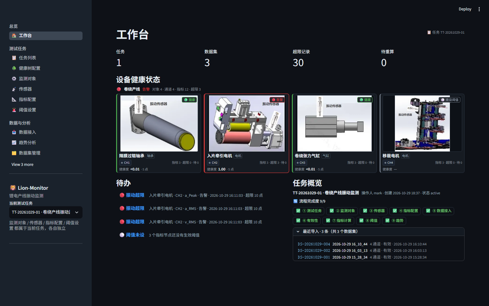
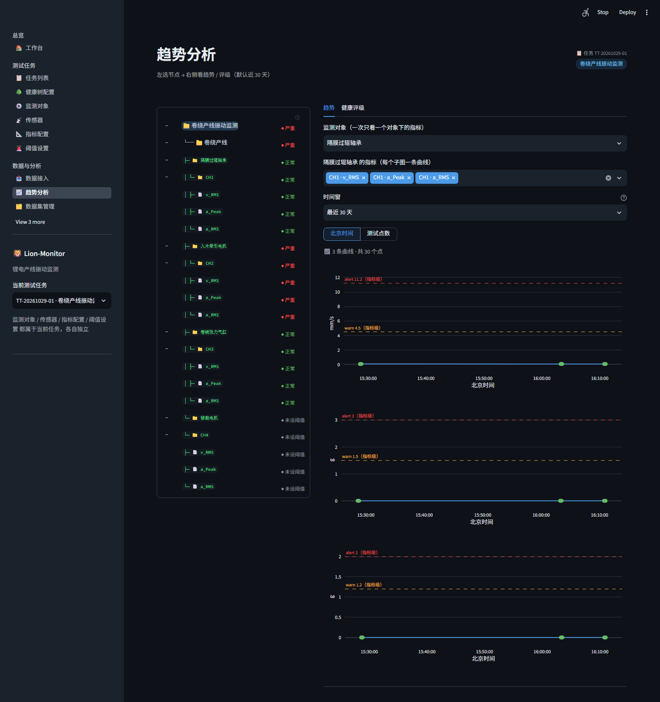
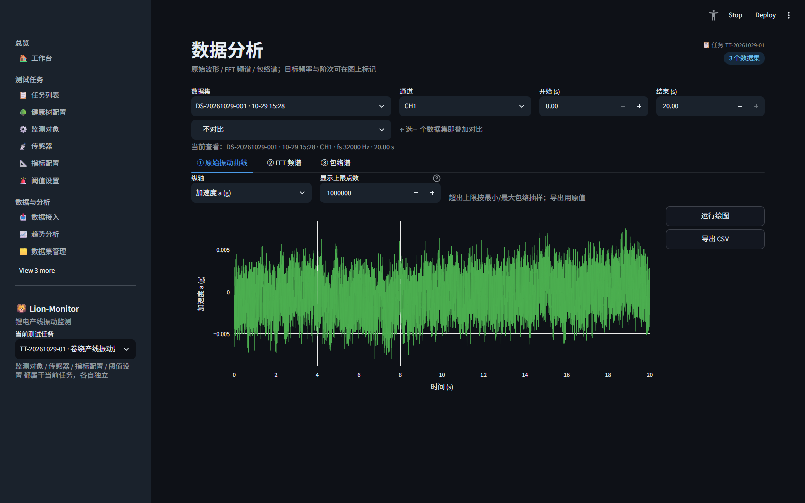
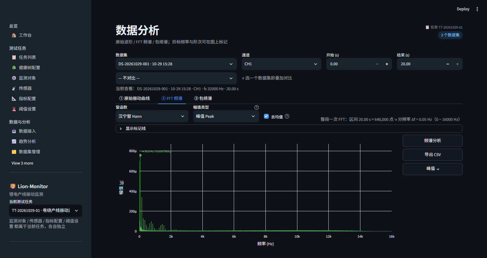

# Lion-Monitor · 锂电产线振动监测

[](https://github.com/mimibebehong/Lion-Monitor/actions/workflows/ci.yml)

面向锂电池产线的**离线振动监测与健康评估**工具：读取四通道采集的 `.dat` 波形，按健康树计算指标、对照阈值，提供趋势分析、健康评级，以及原始波形 / FFT 频谱 / 包络谱分析。界面基于 Streamlit，数据与计算全部在本机完成。



## 功能一览

- **测试任务与健康树**：任务 → 设备 → 监测对象 → 通道 → 指标五级结构，支持模板导入/导出与整树替换。
- **主数据台账**：监测对象、通道、传感器、指标定义独立维护，健康树只做引用装配。
- **数据接入**：扫描目录按批次导入，多通道 `.dat` 自动解析，异常文件跳过并记录原因。
- **指标计算**：`a_Peak`、`a_RMS`、`v_RMS`（10–1000 Hz 带通 + 频域积分）等，参数可按节点覆盖。
- **阈值与告警**：warn / alert 两级阈值，沿健康树向上继承。
- **趋势与健康评级**：每个指标值一个点，不聚合、不抽稀；越限点着色，节点状态取子树最差。
- **数据分析**：原始波形 / FFT 频谱 / 包络谱三种视图，支持窗函数、目标频率与阶次标记、叠加对比与 CSV 导出。
- **数据治理**：软删除 + 回收站、变更审计（旧值 / 新值 / 操作人 / 时间）、数据库在线备份。

## 界面预览

### 工作台

任务与数据集统计、超限记录、设备健康卡片、待办和最近导入一屏总览。


### 趋势分析

左侧按健康树选择节点，右侧查看指标趋势、warn / alert 阈值线与节点健康评级。



### 数据分析：原始波形

支持区间读取与最小/最大包络抽样，可导出逐点数据。



### 数据分析：FFT 频谱

6 种窗函数、峰值/有效值幅值类型、目标频率与阶次竖线，支持导出 CSV。



## 技术栈

- Python 3.11
- Streamlit + Plotly（前端与可视化）
- SQLite + SQLAlchemy（单文件数据库，WAL 模式）
- NumPy / SciPy / pandas（信号处理与数据）
- Inno Setup + C# 启动器（Windows 绿色包 / 安装包）

## 快速开始

### 环境

- Windows 10 / 11
- Python 3.11

### 安装与启动

```bat
python -m venv .venv
.venv\Scripts\activate
pip install -r requirements-win.txt

python run.py run app\main.py
```

浏览器打开 <http://localhost:8501>。首次启动会在 `data/lion.db` 自动建库；空库不会写入示例任务，可在「健康树配置」页恢复内置示例树后再导入数据。

也可以直接双击 `start.bat`（带控制台，便于排障）。

### 测试与静态检查

```bat
pip install pytest pytest-cov ruff
python -m pytest tests -q
python -m ruff check src app tests tools build.py conftest.py
```

### 构建 Windows 便携包（维护者）

```bat
build.bat --no-installer
```

产物在 `dist\`（绿色包，含便携 Python 运行时）；去掉 `--no-installer` 且本机装有 [Inno Setup 6](https://jrsoftware.org/isdl.php) 时，还会生成 `installer\output\LionMonitor-Setup-<版本>.exe`。

> 便携包构建依赖 `.build\` 下的 Python 嵌入版和 `wheels\` 离线依赖缓存；这些大文件不随仓库分发。

## 目录结构

```text
Lion-Monitor/
├── app/                     Streamlit 前端（13 个页面 + 共用 UI/树渲染 + 图标）
├── src/lion_monitor/
│   ├── ingest/              .dat 读取与目录索引
│   ├── features/            指标、波形、频谱、包络、健康评级、导入管线
│   ├── store/               SQLite 存储层（任务 / 健康树 / 台账 / 阈值 / 数据集 / 指标值 / 回收站）
│   ├── viz/                 Plotly / Matplotlib 绘图
│   └── deploy/              环境自检
├── tests/                   单元与集成测试
├── configs/                 产线配置
├── launcher/                Windows 启动器源码（C#）
├── installer/               Inno Setup 安装脚本、图标
├── scripts/                 批处理与现场核验脚本
├── tools/                   构建、日志收集、手册生成等工具
├── screenshots/             README 界面截图
├── run.py                   服务入口（事件循环与日志初始化）
├── build.py                 构建脚本
└── pyproject.toml
```

## 数据格式

采集文件为“512 B 文件头 + float32 little-endian 样本”：

- 采样率在头部 `0x110`，采样点数在 `0x0F0`
- 文件命名：`<日期> <时间>-<通道>_<任务>.dat`，例如 `2026-10-29 15_28_34-CH3_Task1.dat`
- 幅值按头部 `scale` 换算，加速度统一为 `g`；速度指标 `v_RMS` 输出 `mm/s`

数据接入默认扫描目录可用环境变量 `LION_SCAN_DIR` 指定，也可以在页面上选择并记住目录。

## 日志

服务日志统一写入 `logs/lion-monitor.log`（10 MB × 5 轮转），启动信息、Streamlit / uvicorn 日志和页面异常都在这里；`logs/launcher.log` 是双击启动器的日志，`logs/server.log` 只在服务入口启动失败时保留兜底输出。

## 说明

- 单机、单用户使用，不含账号与权限体系。
- 输入为已采集的振动文件；实时采集与 PLC / OPC-UA 接入不在当前版本范围内。
- 默认端口 `8501`，监听 `0.0.0.0` 时局域网内可访问。

参与开发前请先看 [CONTRIBUTING.md](CONTRIBUTING.md)。